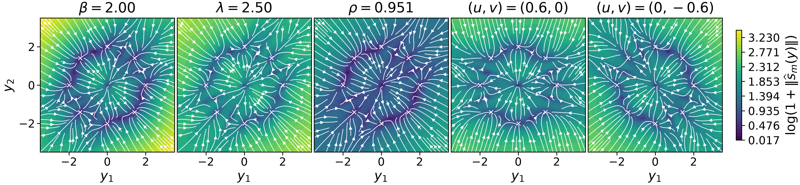

<h1 align="center">Energy-Tweedie</h1>
<h3 align="center">Score meets Score, Energy meets Energy</h3>

<p align="center">
  <a href="https://andleb.netlify.app/">Andrej Leban</a><br>
  Department of Statistics, University of Michigan
</p>

<p align="center">
  <a href="https://neurips.cc/virtual/2026/loc/sydney/poster/150007"></a>
  <a href="https://arxiv.org/abs/2512.23818"></a>
  <a href="https://andleb.netlify.app/publication/et/"></a>
  <a href="https://huggingface.co/papers/2512.23818"></a>
  <a href="https://huggingface.co/andleb/et"></a>
</p>

---

Official code repository for **[Energy-Tweedie: Score meets Score, Energy meets Energy](https://andleb.netlify.app/publication/et/)**, *NeurIPS 2026*

The paper lifts the Tweedie formula to a distributional identity valid for Gibbs noise distributions, with several applications such as a posterior-samples-to-score route, estimating unknown noise parameters from corrupted data, and providing the score-based perspective on recent "distributional" diffusion methods.


<p align="center">
  <a href="exp/reproduce_diffusion_8gauss.ipynb"></a>
  <br>
  <em>Energy-Tweedie score fields for Eight-Gaussians as each noise parameter is varied. Color shows the score magnitude on a log scale.</em>
</p>

<p align="center">
  <a href="#installation"><strong>Installation</strong></a> ·
  <a href="#reproducing-the-results"><strong>Reproduction</strong></a> ·
  <a href="#training"><strong>Training</strong></a> ·
  <a href="#citation"><strong>Citation</strong></a>
</p>

## Installation

Use Python 3.12 or newer. `requirements.txt` installs the default PyTorch build; if you need a different one (for example, a specific CUDA version), install it first. In either case, then run from the repository root:

```bash
python -m venv .venv
source .venv/bin/activate
python -m pip install -r requirements.txt
python -m pip install -e src/engression
```

## Structure

- `exp/`: experiment scripts, reproduction notebooks, and training, sampling, and evaluation settings in `exp/configs/`.
- `utils/`: shared code used by the experiments.
- `models/`: model checkpoints with their training configurations.
- `src/`: vendored third-party code.
- `third_party_licenses/`: third-party licenses and attribution.

## Reproducing the results

The following notebooks reproduce the results presented in the paper. They evaluate the released checkpoints and write their tables and figures under `res/`. Run shell commands from the repository root.

All released checkpoints and their saved configurations are also hosted on [Hugging Face](https://huggingface.co/andleb/et). See the [model card](https://huggingface.co/andleb/et#download) for downloads and loading examples.

| Notebook in `exp/` | Dataset | Reproduces |
| --- | --- | --- |
| [reproduce_score_estimation.ipynb](exp/reproduce_score_estimation.ipynb) | Eight-Gaussians | Three-estimator score comparison, posterior diagnostics, posterior-sample budget, and Richardson clean-score fields |
| [reproduce_parameter_estimation.ipynb](exp/reproduce_parameter_estimation.ipynb) | Eight-Gaussians | Full-SPD noise-parameter recovery with oracle and learned scores, and noise-family controls |
| [reproduce_diffusion_8gauss.ipynb](exp/reproduce_diffusion_8gauss.ipynb) | Eight-Gaussians | Five-parameter sampling: score fields, noise-parameter paths, fixed-parameter controls, and tracking of the exact noisy marginal |
| [reproduce_diffusion_mnist.ipynb](exp/reproduce_diffusion_mnist.ipynb) | MNIST | Five sampling paths: sample grids, matched-RMS progress, nearest training images, and the quantitative comparison |

### Eight-Gaussians

We provide trained model checkpoints in `models/`.
The notebooks generate the data from the Eight-Gaussians mixture. Two notebook sections depend on experiment scripts:

- The score notebook calls `exp/score_comparison_8gauss.py` twice: with `--stage all` to evaluate the ET-DSM and Hyvärinen models on a separately generated, seeded test set and compute their population-loss floors, and with `--stage histories` to export the training and validation losses stored in the checkpoints for the loss curves. 
  
  To run either call in the background instead, use `bash exp/run_score_comparison_8gauss.sh --stage <stage>`, which logs to `exp/logs/`. `all` runs `evaluate` (model evaluation) followed by `floors` (loss floors); `train` retrains the models. The `all`, `evaluate`, and `floors` stages read the evaluation settings and reference bank written by the notebook's "Posterior score and distribution accuracy" cells, so run those first.
  
- The diffusion notebook's section "Fixed-parameter path isolation" compares sampling along the noise-parameter paths with sampling at fixed noise parameters. It calls `exp/sample_diffusion_8gauss_controls.py` to generate the fixed-parameter samples; to run that step in the background instead, use `bash exp/sample_diffusion_8gauss_controls.sh`.

### MNIST

Download `final.pt` from the [MNIST model release](https://github.com/andleb/et/releases/tag/MNIST_model) and place it at `models/mnist/posterior/final.pt`. The checkpoint is also available on [Hugging Face](https://huggingface.co/andleb/et/tree/main/mnist/posterior). Then generate the samples for the five paths, which the notebook loads:

```bash
bash exp/sample_diffusion_mnist.sh
```

The notebook downloads MNIST and the MNIST-12 ONNX evaluation model.

## Training

Model checkpoints are included. To retrain them, use the scripts below. Training uses editable defaults in `exp/configs/`; reproduction above uses the saved configurations in `models/`.

| Command | Models | Configuration in `exp/configs/` |
| --- | --- | --- |
| `bash exp/train_8gauss_gaussian.sh` | Isotropic Gaussian posterior for Richardson score estimation | [train_8gauss_gaussian_isotropic.yaml](exp/configs/train_8gauss_gaussian_isotropic.yaml) |
| `bash exp/train_8gauss_generalized.sh` | Isotropic generalized-Gaussian posterior for Richardson score estimation | [train_8gauss_generalized_isotropic.yaml](exp/configs/train_8gauss_generalized_isotropic.yaml) |
| `bash exp/train_8gauss_full_spd.sh` | Five-parameter Eight-Gaussians posteriors | [train_8gauss_full_spd.yaml](exp/configs/train_8gauss_full_spd.yaml) |
| `bash exp/run_score_comparison_8gauss.sh --stage train` | ET-DSM and Hyvärinen direct-score models | [train_8gauss_score_comparison.yaml](exp/configs/train_8gauss_score_comparison.yaml) |
| `bash exp/train_parameter_estimation_models.sh` | Posterior and score models for parameter estimation | [train_8gauss_parameter_estimation_posterior.yaml](exp/configs/train_8gauss_parameter_estimation_posterior.yaml), [train_8gauss_parameter_estimation_score.yaml](exp/configs/train_8gauss_parameter_estimation_score.yaml) |
| `bash exp/train_mnist.sh` | Five-parameter MNIST posterior | [train_mnist.yaml](exp/configs/train_mnist.yaml) |

Retrained models are saved under `res/models/`. The notebooks use the provided checkpoints by default.

## Citation

If you use this work, please cite the paper:

```bibtex
@inproceedings{leban2026energytweedie,
  title         = {Energy-Tweedie: Score meets Score, Energy meets Energy},
  author        = {Andrej Leban},
  booktitle     = {Advances in Neural Information Processing Systems},
  year          = {2026},
  eprint        = {2512.23818},
  archivePrefix = {arXiv},
  primaryClass  = {stat.ML},
  url           = {https://arxiv.org/abs/2512.23818}
}
```

Citation metadata is also available in [CITATION.cff](CITATION.cff).

## License

Original Energy-Tweedie code and modifications to vendored code are copyright Andrej Leban and licensed under the [BSD 3-Clause license](LICENSE). Third-party components retain their original copyright notices and licenses; see [third-party attribution](third_party_licenses/THIRD_PARTY_LICENSES.md).
